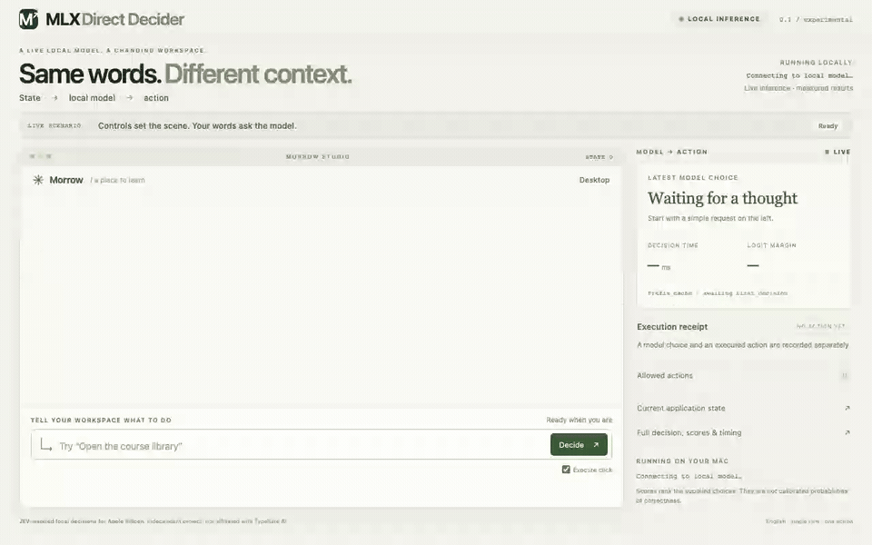

# MLX Direct Decider desktop recording

[Back to home](../../../README.md)

Freshly recorded on 2026-10-14 with **MLX Direct Decider** visible in the interface.
Eight fixed requests drove actual DOM controls through the local Qwen3.5-9B model.
All eight model-choice and execution checks passed, with no browser or recording errors.
This is an illustrative integration walkthrough, separate from the held-out benchmark.

[Full MP4](full-run.mp4) · [Original WebM](original.webm) ·
[Original transcript](transcript.json) · [Artifact hashes](provenance.json)

| Request | Raw model choice | Recorded decision time |
| --- | --- | ---: |
| Close it | `__no_match__` | 2445.6 ms |
| Close it | `close.notes` | 443.6 ms |
| First one | `play.orbit` | 2471.6 ms |
| Pause it | `player.pause` | 1525.4 ms |
| Did you just close it? | `__no_match__` | 2533.6 ms |
| Close it | `close.player` | 553.8 ms |
| Close it | `close.library` | 463.1 ms |
| Close it | `__no_match__` | 546.8 ms |

These individual timings belong to this recording, not a latency distribution.
The model was already loaded and its prefix cache had been used by the preceding
browser capture; this is not a startup or cold-cache measurement. Each original
cache record, manual setup click, model response and execution receipt is retained.
Decline scenes accept either `no_match` or `abstain`; the model returned `no_match`.

The MP4 and GIF preserve the complete timeline at **1× speed**, including inference
waits and presentation pauses. Encoding, GIF dimensions, frame rate and colors may
change; the displayed model outputs and original screenshots have not been retouched.
The desktop and player are fictional public examples with allowlisted controls.

The capture used a clean export of committed source plus the recorded branding
patch, excluding unrelated working-tree edits. See [source identity](source.json),
[branding patch](source.patch), and the source-file hashes in the transcript.
The earlier recording remains unchanged in [the historical report](../live-demo/README.md).

[Reproduce the recording](../../http-and-demo.md#interactive-showcase).
